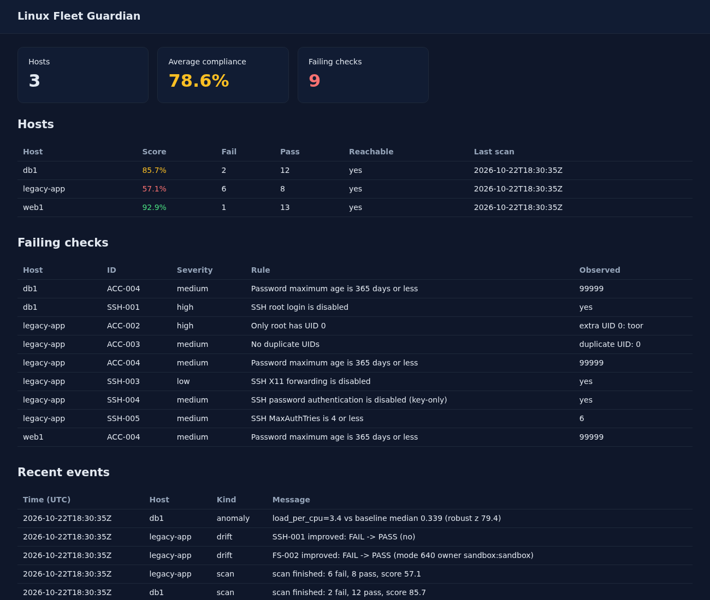
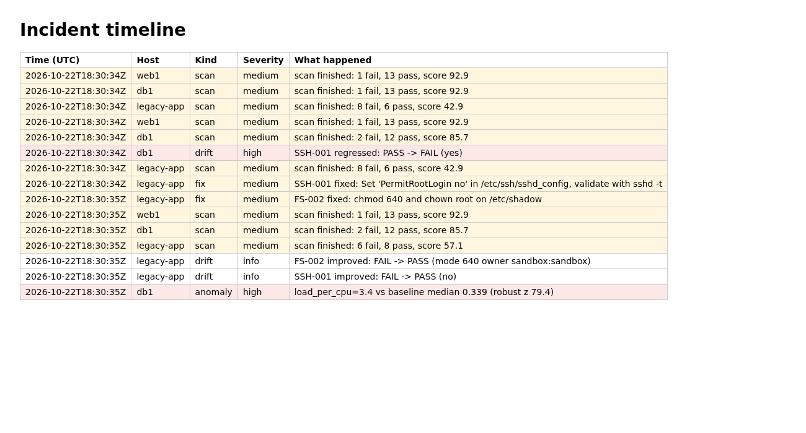

# Linux Fleet Guardian

[](https://github.com/AKASH991833/linux-fleet-guardian/actions/workflows/ci.yml)
  

One small tool to **audit, fix, back up and watch** a handful of Linux servers, without installing an agent on them.

- **Scan** many hosts over SSH with CIS-style checks and get a score per host.
- **Detect drift**: know when a setting that used to be right is wrong again.
- **Fix safely**: dry run first, every change snapshotted, verified afterwards, rolled back automatically if it does not work.
- **Prove your backups**: restore them into a scratch directory and compare every file hash. Run a full **DR drill** and get a measured recovery time.
- **Spot anomalies** in load, memory and disk with a robust baseline (median and MAD, not a fixed threshold).
- **Explain incidents**: one timeline of scans, drift, fixes, rollbacks, anomalies, drills and brute-force bursts from your auth log.
- **See it**: read-only web panel, Prometheus `/metrics`, Grafana dashboard, alert rules.
- **Extend it**: add checks with a JSON file (no code) or a small Python plugin.

Pure Python standard library. Runs on Python 3.6 or newer (RHEL 8 and up, Ubuntu, Debian, Fedora).



*The screenshot is made from synthetic demo hosts (`examples/make_demo.py`), not from real servers.*

## Quick start

```sh
git clone https://github.com/AKASH991833/linux-fleet-guardian && cd linux-fleet-guardian

python3 -m fleetguard scan                       # audit this machine
python3 -m fleetguard fix                        # show what it would change (dry run)
sudo python3 -m fleetguard fix --apply           # change it, with snapshots and auto-rollback
python3 -m fleetguard rollback --list            # see what was changed
python3 -m fleetguard rollback <journal-id>      # undo one change
```

A fleet is a small INI file ([examples/inventory.ini](examples/inventory.ini)):

```sh
python3 -m fleetguard scan -i examples/inventory.ini --save-baseline   # remember the good state
python3 -m fleetguard scan -i examples/inventory.ini --drift           # exit 3 if something regressed
python3 -m fleetguard scan -i examples/inventory.ini --format junit -o scan.xml --fail-on high
```

Install as a package: download the `.deb` or `.rpm` from the [releases](https://github.com/AKASH991833/linux-fleet-guardian/releases), or build one with `make deb` / `make rpm`. An [Ansible role](ansible/roles/fleetguard) installs it plus a systemd service.

## Backups you can trust

```sh
fleetguard backup run --source /srv/app --dest /backup --name app --dump-cmd 'mysqldump --all-databases'
fleetguard backup restore-test --dest /backup --rpo 86400 --rto 300 --verify-cmd 'test -s "$RESTORE_DIR/_dump.out"'
fleetguard drill --source /srv/app --rpo 86400 --rto 300 --report drill.md
```

`restore-test` checks the archive hash, extracts safely into a scratch directory, compares every file with the manifest, runs your own verify command, and reports restore time (RTO) and backup age (RPO). `drill` does the whole disaster on a scratch copy: back up, delete the copy, restore, compare, time it, write a report. It never writes to your source.

## Watching

```sh
fleetguard perf check -i inventory.ini      # run from cron every few minutes; needs 12 samples before it alerts
fleetguard serve -i inventory.ini --scan-interval 3600    # panel on http://127.0.0.1:9877, /metrics for Prometheus
fleetguard timeline --hours 24 --auth-log /var/log/auth.log -o incident.md
docker compose -f monitoring/docker-compose.yml up --build   # Guardian + Prometheus + Grafana demo
```



## Add your own check

No code, a JSON file in a plugins directory:

```json
[{"id": "CUS-001", "title": "Login banner mentions authorized use", "severity": "low",
  "file": "/etc/issue.net", "regex": "[Aa]uthori[sz]ed", "expect": "present"}]
```

```sh
fleetguard scan --plugins ./plugins --check CUS-001
```

Python plugins can do anything a shell probe can. See [docs/WRITING_CHECKS.md](docs/WRITING_CHECKS.md).

## What is verified, and how

CI (GitHub Actions) runs on every push. Results are in the Actions tab; the table says what each job proves.

| Claim | Evidence |
|---|---|
| Unit tests pass (Python 3.8 and 3.12) | `unit` job. 50+ tests. |
| Works on Python 3.6 (RHEL 8) | `distros` job on `rockylinux:8`. |
| Runs on Ubuntu 22.04/24.04, Debian 12/13, Rocky 8/9, Alma 9, CentOS Stream 9, Fedora, UBI 9 | `distros` job: unit tests, a live scan with no ERROR results, backup restore-test, DR drill. |
| Fixes really work and roll back | Same job: on each real container, `fix --apply` edits the real `/etc/ssh/sshd_config`, the real `sshd -t` accepts it, rollback is byte-identical (`cmp`). |
| SSH fleet scanning, sudo, unreachable host detection, fix/rollback over SSH | `ssh-fleet` job against a real sshd on the runner (loopback; "different hosts" are aliases of one machine). |
| `.deb` and `.rpm` install, run and remove cleanly | `packages` + `package-install` jobs on 8 distros. |
| Ansible role converges, second run changes nothing, service answers | `ansible` job (Ubuntu runner with systemd). |
| Alert rules are valid and fire as intended; Prometheus scrapes Guardian; Grafana loads the dashboard | `monitoring` job (promtool unit tests plus the compose stack). |

What is **not** claimed:

- No benchmark certification. "CIS-style" means the rules follow CIS Benchmark topics. Check IDs here are Guardian's own. It is not CIS-CAT and does not quote benchmark numbering.
- Fleet scale was not load-tested. It scans hosts in parallel threads (default 8); it was exercised with a few hosts.
- The sysctl fixes could not be applied inside CI containers (kernel parameters are read-only there), so those fixes are covered by unit tests of the logic and by the verify-then-roll-back path, not by a real kernel change.
- No firewall, audit-daemon, or package-update checks yet.
- Not tested on non-systemd init systems or on non-Linux hosts.
- The web panel has no login screen; use the bearer token and a TLS reverse proxy if you expose it.

## Learn how it works

[LEARN.md](LEARN.md) walks through the ideas (idempotent fixes, drift, restore tests, RTO/RPO, robust statistics) with small exercises. [docs/ARCHITECTURE.md](docs/ARCHITECTURE.md) maps the code. [docs/CHECKS.md](docs/CHECKS.md) lists every rule.

## Files

| Path | What |
|---|---|
| `fleetguard/` | The tool (stdlib only) |
| `plugins/` | Example plugins |
| `monitoring/` | Prometheus rules (with tests), Grafana dashboard, compose demo |
| `ansible/` | Role and example playbook |
| `packaging/` | `.deb` / `.rpm` builders, systemd unit |
| `tests/` | Unit tests and CI scripts |

## License

MIT. See [SECURITY.md](SECURITY.md) for the security model and [CONTRIBUTING.md](CONTRIBUTING.md) to help.
